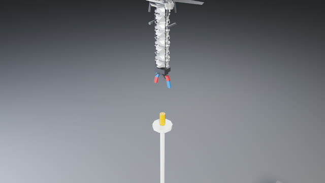
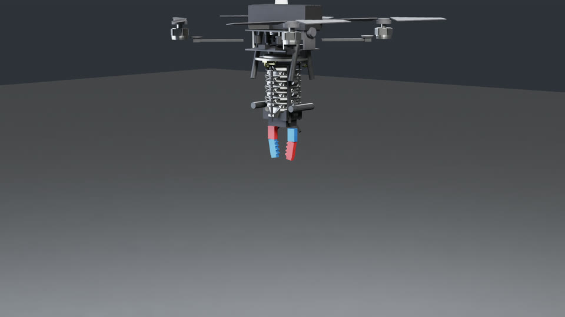
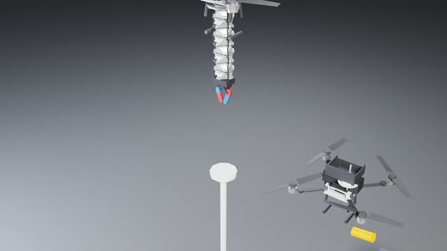
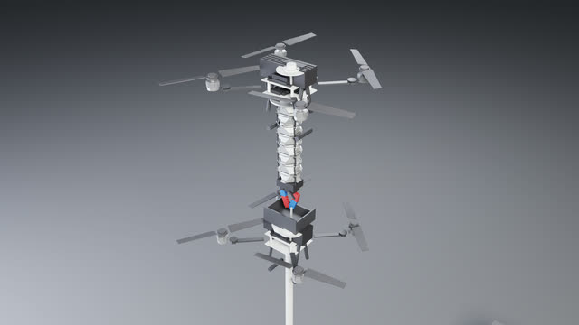
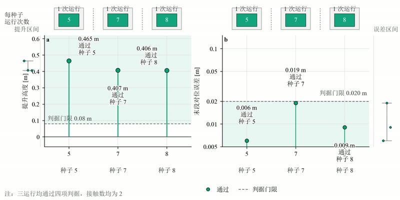

# AerialSoftArm

[English](README.md) | [简体中文](README.zh-CN.md)

**靠弯曲完成抓取的刚柔耦合空中机械臂——基座冻结，软臂接管。**


<p align="center">
  
  &nbsp;
  
</p>
<p align="center"><em>左：Isaac Lab 中的全自主抓取流程。右：真机桁架软臂。</em></p>

---

## 💡 核心思路

空中抓取同时耦合了三个难题：机械臂运动时基座必须保持位置，夹爪要依靠腕部相机完成毫米级对位，接触还不能把飞行器拽得失稳。用一个漂浮基座同时对抗这三个问题是一场必输的博弈——机械臂的反力矩经机身传回视觉回路，伺服最终在追自己的扰动。

**我们把问题一分为二。** 刚性桁架骨架承担载荷、维持位姿；软体弯曲段负责对位与柔性捕获。飞行器只负责粗定位，**然后就停下来**——剩余的每一个自由度都归软臂。捕获过程是诚实的：零件靠两根手指持续接触夹持，而不是仿真里的直接绑定。

---

## ⚡ 亮点

- **刚柔双结构机械臂** — 8 自由度桁架软臂（bx/by 双轴弯曲 + 伸缩脊柱 + 三腱索耦合）；刚性段承载保形，软段对位与捕获
- **基座冻结下的弯曲主导对位** — 消除自由漂浮操作中普遍存在的基座—机械臂振荡耦合；弯-雅可比视觉伺服接管最后几厘米
- **在线复合惯量自适应** — 伸臂使整机惯量膨胀约 2.5 倍；复合惯量每 0.5 s 重算一次，姿态回路在整段伸展过程中保持收敛
- **接触诚实的捕获协议** — 两根手指必须同时保持接触 0.3 s 才算夹住；没有单点触碰或重力辅助的捷径
- **毫米级视觉伺服** — 腕部相机定位噪声底约 2 mm，把最终对位误差压进 2 cm 以内
- **站得住的状态估计** — 15 维误差状态 EKF，逐传感器 NIS 门控，速度 RMS 相比互补滤波基线降低 73%
- **端到端自主** — 视觉锁定 → 粗定位 → 伸臂 → 弯曲对位 → 捕获 → 提升，另含双机中继交接的相对位姿控制

---

## 📋 系统概览


*图 1：平台组成——四旋翼基座、桁架软臂、腕部相机、双指夹爪与零件支架。*

系统面向无法提供降落基面的零件取回场景：无人机到场、在目标上方稳定悬停，并在悬停状态下完成整个抓取。腕部相机锁定零件，基座取粗定位并保持不动，软臂伸展、弯曲对位、闭合。第二架无人机可用托盘在空中间接收取零件。


---

## 🎬 图集

<table>
  <tr>
    <td align="center"><br><sub>悬停至支架上方</sub></td>
    <td align="center"><br><sub>伸展软臂</sub></td>
    <td align="center"><br><sub>弯曲对位</sub></td>
    <td align="center"><br><sub>捕获与提升</sub></td>
  </tr>
  <tr>
    <td align="center"><br><sub>夹爪特写</sub></td>
    <td align="center"><br><sub>A 机持件待交接</sub></td>
    <td align="center" colspan="2"><br><sub>交接给 B 机</sub></td>
  </tr>
</table>

---

## 📊 结果


*图 2：伺服窗口内的水平对位误差——弯曲伺服把残差压进视觉噪声量级后才触发捕获。*


*图 3：各类子按四项成功判据的逐次试验结果。*

在评测运行中，流水线收敛到 **2 cm 以内的最终对位误差**（视觉噪声底约 2 mm），并在捕获后把 37 g、Ø28×60 mm 的零件**提升 0.4 m 以上**。基座冻结协议在伸臂、0.5–1.0 N·m 的弯曲反力矩和捕获瞬态下都保持了悬停位置——这正是我们开发过程中试过的所有自由漂浮基线失败的模式。双机交接中，接收机保持托盘位姿固定，供机释放零件后完成转移。

---

## 📦 仓库结构

| 路径 | 内容 |
|---|---|
| `isaac/` | Isaac Lab 实验——`fc_align.py` 抓取流水线、估计器、飞行控制、标定、URDF/USD 资产 |
| `isaac/embodied/` | 纯 numpy 飞行控制器、Mahony / EKF / 融合估计器、视觉链路 |
| `arm_real/` | 真机桁架臂 MuJoCo 建模流水线（网格 → XML）+ 贴图 |
| `panel/` | 键盘操作面板，含 MuJoCo 视图与 sim2real 标定导出 |
| `grasp_pipelines/` | Soft-Spiral 抓取脚本（手动 / 脚本 / 视觉）on MuJoCo |
| `arm_demo/` | MuJoCo 软臂与空中抓取演示 |
| `docs/` | 论文（`paper_full_en.docx`）与技术报告 |
| `env/` | 锁定的 `requirements.txt` 与 Python 版本 |
| `media/` | README 演示与图件 |

---

## 🚀 快速开始

**Isaac 侧** — Python 3.11、Isaac Sim 5.1 + Isaac Lab 2.3、RTX GPU（完整锁定清单见 `env/requirements.txt`）：

```powershell
$env:OMNI_KIT_ACCEPT_EULA = "YES"
$env:PYTHONIOENCODING = "utf-8"
$py = "<env_isaaclab 中的 python>"

# 主实验：单机对位抓取（约 25 分钟 headless，末尾输出 PASS 判据行）
& $py isaac\fc_align.py --headless --enable_cameras --out runs/fc_align_v7 `
  --eye 0.38,-0.45,0.18 --seed 5 --kp-vel 2.5 --kp-pos 0.4 --ki-att 0.10 --est-g 0.35

# 四夹爪抓取套件、雅可比标定、实验矩阵
& $py isaac\run_grasp.py --gripper diamond --headless --out runs/grasp_diamond
& $py isaac\calib_jac.py --headless
& $py isaac\run_matrix.py
```

**MuJoCo 侧** — `pip install mujoco pillow numpy pyyaml textual`：

```powershell
python arm_demo\aerial_grasp.py
python grasp_pipelines\spiral_grasp_scripted.py
python -m panel
```

---

## 🧩 组件

| 组件 | 作用 |
|---|---|
| `isaac/fc_align.py` | 对位抓取状态机：视觉定位 → 弯曲伺服 → 双指捕获 → 提升 |
| `isaac/embodied/estimator_ekf.py` | 15 维误差状态 EKF（p, v, q, b_a, b_g），接受 GNSS / 气压 / 重力更新 |
| `isaac/tendon_model.py` | 三腱索 ↔ 关节空间耦合：张力、预紧、库仑摩擦与迟滞 |
| `isaac/calib_jac.py` | 零重力步进标定，测弯曲与质心雅可比 |
| `arm_real/arm_lattice.py` | 含腱索走线的桁架臂 MuJoCo 模型——与 Isaac 资产同一套运动学 |
| `panel/` | 实时键盘遥操作、调参、日志与 sim2real 标定导出 |

---

## 📄 引用

如果这项工作对你有帮助，请引用：

```bibtex
@software{AerialSoftArm2026,
  author = {Yu, Bohan},
  title  = {AerialSoftArm: Rigid-Soft Aerial Manipulation in Isaac Lab},
  year   = {2026},
  url    = {https://github.com/yubohann/AerialSoftArm}
}
```

---

## 许可证

MIT，见 [LICENSE](LICENSE)。`grasp_pipelines/spiral_repo/` 下内置的 Soft-Spiral 代码保留其自身的 MIT 许可证，见 [THIRD_PARTY_NOTICES.md](THIRD_PARTY_NOTICES.md)。
